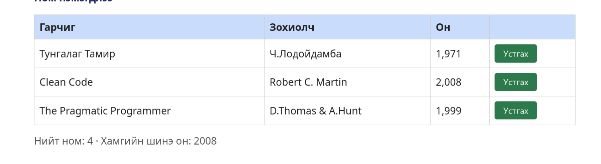

# BUG-01: Нийт номын тоолуур жагсаалтын тооноос нэгээр их

Төрөл: Өгөгдөл / статистик
Орчин: Уншлагын жагсаалт v2.0, Debian GNU/Linux 13.7, Node.js v20.20.2; session-ийн browser: Codex in-app browser (engine version харагдаагүй), 2026-11-26.
Урьдчилсан нөхцөл: `node app.js`-ийг шинээр асааж, анхны 3 номтой төлөвөөс эхэлнэ.
## Дахин гаргах алхам
1. Серверийг шинээр асаана.
2. `http://localhost:3000/` нээнэ.
3. Хүснэгтийн мөрүүдийг тоолж “Нийт ном” утгатай харьцуулна.
4. Нэмэлт баталгаа: `curl -i http://localhost:3000/api/books` болон `/api/stats` ажиллуулна.

Хүлээгдэж байсан: 3 номын мөртэй үед UI болон API-ийн нийт 3 байх.
Бодит үр дүн: Хүснэгтэд 3 ном байна, UI ба API `total: 4` гэж харуулна. Нэг ном устгахад 2 мөртэй атлаа `total: 3` хэвээр.
Ноцтой байдал: Minor — статистик буруу боловч номын жагсаалтын өгөгдөл өөрчлөгдөөгүй.
Олдсон аялал: Supermodel (GUI), Fed-Ex (жагсаалт ба статистикийг тулгах).

## Нотолгоо

API-ийн list/stats гаралт: `../evidence/count-books-response.txt`, `../evidence/count-stats-response.txt`.
