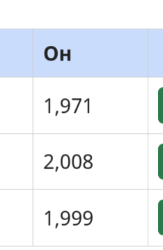

# BUG-02: Он хүснэгтэд мянгатын таслалтай харагдана

Төрөл: GUI / формат
Орчин: Уншлагын жагсаалт v2.0, Debian GNU/Linux 13.7, Node.js v20.20.2; session-ийн browser: Codex in-app browser (engine version харагдаагүй), 2026-11-26.
Урьдчилсан нөхцөл: `node app.js`-ийг шинээр асааж, анхны 3 номтой төлөвөөс эхэлнэ.
## Дахин гаргах алхам
1. Серверийг шинээр асаана.
2. Нүүр хуудсыг нээнэ.
3. `2008` онтой Clean Code мөрийн оныг шалгана.

Хүлээгдэж байсан: Он энгийн тоогоор `2008` гэж харагдах.
Бодит үр дүн: `2,008` гэж харагдана; бусад онуудад ч мянгатын таслал нэмэгдэнэ.
Ноцтой байдал: Minor — өгөгдөл өөрчлөгдөөгүй ч заасан форматтай зөрчилдөнө.
Олдсон аялал: Supermodel (GUI).

## Скриншот

