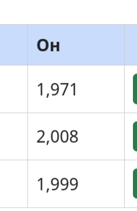

# BUG-02: Хүснэгтийн «Он» баганад жил мянгатын таслалтай (2,008) харагддаг

Орчин: Уншлагын жагсаалт v2.0, Firefox, Debian Linux, 2026-10-21
Урьдчилсан нөхцөл: node app.js-ийг шинээр асаасан (анхны 3 ном)

## Дахин гаргах алхам
1. node app.js-ийг шинээр асаа.
2. http://localhost:3000 нээ.
3. Хүснэгтийн «Он» баганыг хар.

Хүлээгдэж байсан: Спецификац: он хүснэгтэд энгийн тоогоор харагдана (жишээ нь 1999).
Бодит үр дүн:     1,971 · 2,008 · 1,999 гэж таслалтай харагдана.

Ноцтой байдал: Cosmetic. Утга зөв, зөвхөн формат буруу.
Хавсралт:      
Олдсон аялал:  Supermodel (GUI)