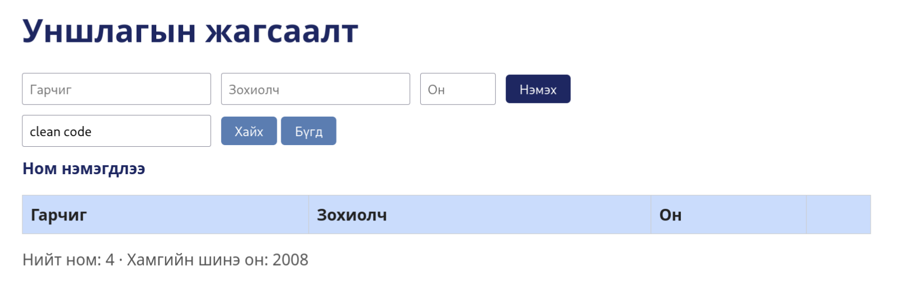

# BUG-03: Хайлт том жижиг үсэг ялгаж байна

Төрөл: Функциональ / хайлт
Орчин: Уншлагын жагсаалт v2.0, Debian GNU/Linux 13.7, Node.js v20.20.2; session-ийн browser: Codex in-app browser (engine version харагдаагүй), 2026-11-26.
Урьдчилсан нөхцөл: `node app.js`-ийг шинээр асааж, анхны 3 номтой төлөвөөс эхэлнэ.
## Дахин гаргах алхам
1. Серверийг шинээр асаана.
2. Хайлтад `clean` гэж жижиг үсгээр бичээд `Хайх` дарна.
3. Хайлтын талбарт `Clean` гэж бичээд дахин хайна.

Хүлээгдэж байсан: Гарчиг, зохиогчийн хайлт том/жижиг үсэг үл харгалзан ижил номыг олох.
Бодит үр дүн: `clean` үр дүнгүй; `Clean` Clean Code-ийг олно. Зохиогчийн `martin` мөн олдохгүй, `Martin` олдоно.
Ноцтой байдал: Major — хэрэглэгч зөв бичсэн хайлтаар номоо олохгүй байж болно.
Олдсон аялал: Supermodel (GUI), Saboteur (API query).

## Скриншот

