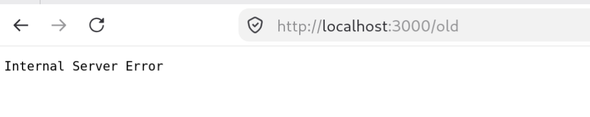

# BUG-04: /old хуудас 500 Internal Server Error буцаадаг

Орчин: Уншлагын жагсаалт v2.0, Firefox, Debian Linux, curl.exe , 2026-10-21
Урьдчилсан нөхцөл: node app.js-ийг шинээр асаасан (анхны 3 ном)

## Дахин гаргах алхам
1. node app.js-ийг шинээр асаа.
2. Браузерт http://localhost:3000/old хаягийг нээ.
3. (Нотолгоо) PowerShell дээр: curl.exe -s -i http://localhost:3000/old

Хүлээгдэж байсан: Спецификац: бүх хуудас, линк ажиллана.
Бодит үр дүн:     «Internal Server Error», HTTP/1.1 500 Internal Server Error.

Ноцтой байдал: Major. Холбоос ажиллахгүй, хэрэглэгч хуудас үзэж чадахгүй.
Хавсралт:       · evidence/bug-04-curl.txt
Олдсон аялал:  Saboteur