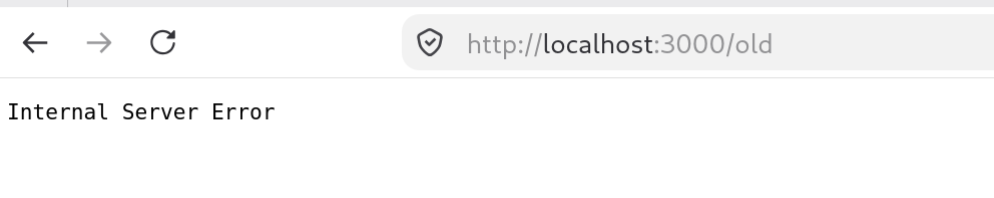

# BUG-04: Хуучин хувилбарын холбоос HTTP 500 буцаана

Төрөл: Холбоос / HTTP
Орчин: Уншлагын жагсаалт v2.0, Debian GNU/Linux 13.7, Node.js v20.20.2; session-ийн browser: Codex in-app browser (engine version харагдаагүй), 2026-11-26.
Урьдчилсан нөхцөл: `node app.js`-ийг шинээр асааж, анхны 3 номтой төлөвөөс эхэлнэ.
## Дахин гаргах алхам
1. Серверийг асаагаад нүүр хуудсыг нээнэ.
2. Доод хэсгийн “Хуучин хувилбар” холбоосыг дарна.

Хүлээгдэж байсан: Холбоос ажиллаж хуудас үзүүлэх эсвэл хэрэглэгчид ойлгомжтой redirect хийх.
Бодит үр дүн: `Internal Server Error`; `curl -i http://localhost:3000/old` нь HTTP 500 буцаана.
Ноцтой байдал: Major — аппын харагдах холбоосын destination огт ажиллахгүй.
Олдсон аялал: Supermodel (GUI), Saboteur (HTTP шалгалт).

## Скриншот ба API нотолгоо

`../evidence/bug-04-curl.txt`
