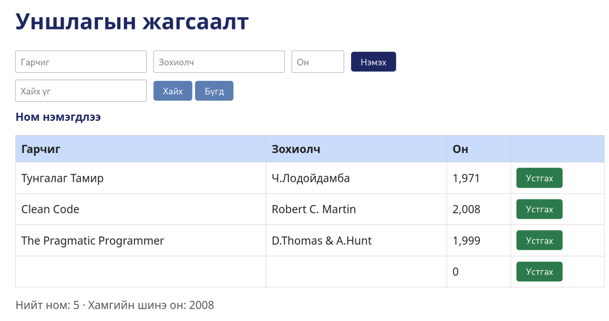

# BUG-05: Хоосон эсвэл дутуу талбартай ном нэмэгдэнэ

Төрөл: Validation / өгөгдөл
Орчин: Уншлагын жагсаалт v2.0, Debian GNU/Linux 13.7, Node.js v20.20.2; session-ийн browser: Codex in-app browser (engine version харагдаагүй), 2026-11-26.
Урьдчилсан нөхцөл: `node app.js`-ийг шинээр асааж, анхны 3 номтой төлөвөөс эхэлнэ.
## Дахин гаргах алхам
1. Серверийг шинээр асаана.
2. Нүүр дээр Гарчиг, Зохиолч, Он гурван талбарыг хоосон үлдээнэ.
3. `Нэмэх` дарна.
4. Нэмэлт API баталгаа: хоосон body, `{}` эсвэл зөвхөн `title` талбартай POST илгээнэ.

Хүлээгдэж байсан: Заавал талбар дутвал ном нэмэгдэхгүй, ойлгомжтой validation мессеж гарах.
Бодит үр дүн: Хоосон гарчиг/зохиолчтой мөр, `0` онтойгоор нэмэгдэж “Ном нэмэгдлээ” гэж харагдана. API-ийн хоосон, дутуу болон `[]` body мөн HTTP 201 авна.
Ноцтой байдал: Major — буруу бичлэг жагсаалт болон статистикт хадгалагдана.
Олдсон аялал: Couch Potato, Saboteur.

## Скриншот ба API нотолгоо

`../evidence/empty-body.txt`, `../evidence/missing-fields.txt`, `../evidence/array-json.txt`
