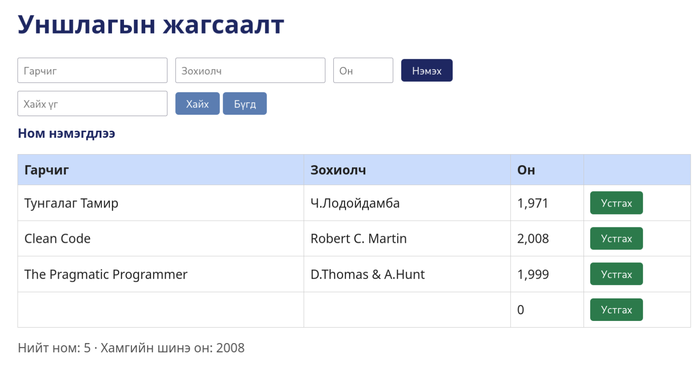

# BUG-05: Бүх талбар хоосон байхад ном нэмэгдэж, 0 онтой хоосон мөр үүсдэг

Орчин: Уншлагын жагсаалт v2.0, Firefox, Debian Linux, 2026-10-21
Урьдчилсан нөхцөл: node app.js-ийг шинээр асаасан (анхны 3 ном)

## Дахин гаргах алхам
1. node app.js-ийг шинээр асаа.
2. http://localhost:3000 нээ.
3. Гарчиг, Зохиолч, Он талбарыг ХООСОН орхиж, ном нэмэх товчийг дар.

Хүлээгдэж байсан: Спецификац: гурван талбар бүгд заавал бөглөгдсөн байх ёстой; дутуу бол ном нэмэгдэхгүй, ойлгомжтой алдааны мессеж харагдана.
Бодит үр дүн:     Алдааны мессеж харагдахгүй, хүснэгтэд хоосон нэр, 0 онтой мөр нэмэгдэнэ.

Ноцтой байдал: Major. Баталгаажуулалт ажиллахгүй, өгөгдөлд хог орно.
Хавсралт:      
Олдсон аялал:  Couch Potato (хоосон оролт)