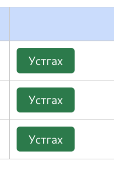

# BUG-06: Устгах товч ногоон өнгөтэй

Төрөл: GUI / харагдац
Орчин: Уншлагын жагсаалт v2.0, Debian GNU/Linux 13.7, Node.js v20.20.2; session-ийн browser: Codex in-app browser (engine version харагдаагүй), 2026-11-26.
Урьдчилсан нөхцөл: `node app.js`-ийг шинээр асааж, анхны 3 номтой төлөвөөс эхэлнэ.
## Дахин гаргах алхам
1. Серверийг шинээр асааж жагсаалтыг нээнэ.
2. `Устгах` товчны өнгийг шалгана.

Хүлээгдэж байсан: Destructive үйлдэл гэдгийг ялгахын тулд товч улаан байна.
Бодит үр дүн: Товч ногоон өнгөтэй харагдана.
Ноцтой байдал: Cosmetic — үйлдэл ажилладаг боловч өнгөний зааврыг зөрчинө.
Олдсон аялал: Supermodel (GUI).

## Скриншот

