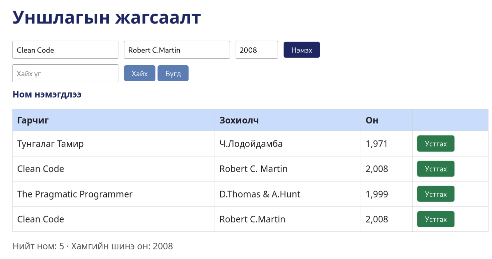

# BUG-07: Ижил нэр, зохиолчтой ном давхар бүртгэгдэнэ

Төрөл: Өгөгдлийн бүрэн бүтэн байдал
Орчин: Уншлагын жагсаалт v2.0, Debian GNU/Linux 13.7, Node.js v20.20.2; session-ийн browser: Codex in-app browser (engine version харагдаагүй), 2026-11-26.
Урьдчилсан нөхцөл: `node app.js`-ийг шинээр асааж, анхны 3 номтой төлөвөөс эхэлнэ.
## Дахин гаргах алхам
1. Серверийг шинээр асаана. Жагсаалтад Clean Code / Robert C. Martin бий.
2. Гарчиг `Clean Code`, зохиолч `Robert C. Martin`, он `2008` гэж оруулна.
3. `Нэмэх` дарна.

Хүлээгдэж байсан: Ижил гарчиг, зохиолчтой давхардсан бичлэг нэмэгдэхгүй.
Бодит үр дүн: Ижил нэр/зохиолчтой хоёр дахь мөр нэмэгдэж, API POST HTTP 201 буцаана.
Ноцтой байдал: Major — жагсаалтын давхардал, статистик болон хайлтын үр дүнд нөлөөлнө.
Олдсон аялал: Supermodel (GUI), Saboteur (API).

## Скриншот ба API нотолгоо

`../evidence/duplicate-api.txt`
